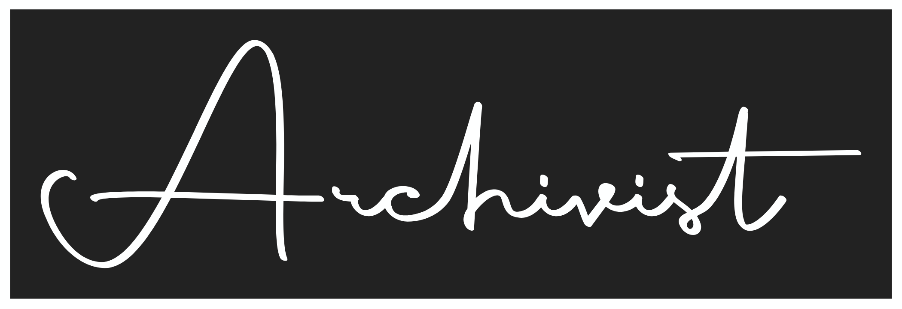

# Archivist

[](https://github.com/Leofric99/archivist)

<p align="center">
  
</p>

<p align="center">
  <a href="#what-is-archivist">About</a> &nbsp;|&nbsp;
  <a href="#features">Features</a> &nbsp;|&nbsp;
  <a href="#installation">Installation</a> &nbsp;|&nbsp;
  <a href="#running-archivist">Run Archivist</a>
</p>

<h3 align="center">A collection of tools for organizing and preserving photo and video archives.</h3>

## What Is Archivist?

Archivist is a utility for managing photographs and videos. It runs a small web server **on your own computer** and opens a browser GUI where you can browse a folder of media, select files, and apply every tool: standardize filenames using dates, work with image metadata, add visible information to media, and organize files into a consistent folder structure.

Everything stays on your machine. In browser mode, the server only listens on `127.0.0.1`; the Windows desktop app embeds the GUI and dispatches its API calls directly to the application without starting a network server. Files are read from disk where they already are (nothing is uploaded), and no external services, fonts or scripts are used. A terminal menu is still available with `--cli`.

## Features

### Photographs

- **Rename photographs:** Standardizes filenames using the date from metadata or user input. Formats filenames as `YYYYMMDD_HHMMSS[_suffix][_{n}].ext` and supports digital and film scans, subfolders, RAW files, and custom suffixes.
- **Burn in information:** Adds a visible date and optional text to photographs, with basic and verbose (per-photo caption) modes and a live preview. The verbose caption band has a font picker listing the fonts installed on your computer (plus any `.ttf`/`.otf` files you drop into `fonts/`), defaulting to Courier New.
- **Crop photographs:** Draw a crop box on each photo in the browser, freeform or locked to a ratio (1:1, 5:4, 4:3, 3:2, 7:5, 16:9, 2:1 or a custom W:H, with a rotate-ratio button). Drag to move, use the handles or arrow keys to resize, step through a multi-photo selection, or centre-crop everything else to one ratio. EXIF rotation is respected, and results go to an output folder unless you choose to overwrite.
- **Manage metadata:** Clone metadata from another photograph, export image metadata to CSV or JSON, and import metadata from a previously exported file.
- **Restructure folders:** Copies photographs and videos into a hierarchy by decade, year, and event, based on filenames in the standard date format.

### Videos

- **Rename videos:** Standardizes video filenames using a detected or custom date, in the format `YYYYMMDD_HHMMSS[_suffix][_{n}].ext`.
- **Burn in metadata:** Adds a visible date and optional text overlay to videos. Requires `ffmpeg` to be installed and available on your system path.

## Installation

Clone the repository, then follow the setup steps for your operating system:

```bash
git clone https://github.com/Leofric99/archivist.git
cd archivist
```

Archivist needs Python 3.11 or newer, the Exiv2 library (used for metadata), and `ffmpeg` for video features. No GUI toolkit is needed: the interface is a web page served from your own machine and opened in your normal browser.

### macOS (Homebrew)

```sh
brew install python@3.11 inih exiv2 ffmpeg
"$(brew --prefix python@3.11)/bin/python3.11" -m venv .venv
source .venv/bin/activate
python -m pip install -r requirements.txt
```

#### macOS desktop app

To build a native macOS app and installer from the repository root (requires `brew install python@3.11`):

```sh
.dev/build-macos.sh
```

The script installs the build dependencies into `.dev/build/venv-macos`, packages the embedded GUI as `.dev/dist/Archivist.app`, and creates `.dev/dist/Archivist-Setup.dmg`. Open the disk image and drag Archivist into Applications; installing a newer version over the old one updates it in place. The app is built for the architecture of the Mac that builds it and is ad-hoc signed; set `CODESIGN_IDENTITY="Developer ID Application: ..."` to sign it with your own identity. On first launch of an ad-hoc signed app, right-click it and choose **Open**. Like the Windows app, it starts no network listener and works through an in-process bridge, and you can drop photos onto its window. Video features still need `ffmpeg` (the app also looks in `/opt/homebrew/bin` and `/usr/local/bin`).

### Linux (Debian / Ubuntu)

```sh
sudo apt-get update
sudo apt-get install python3 python3-venv libexiv2-dev libinih-dev ffmpeg
/usr/bin/python3 -m venv .venv
source .venv/bin/activate
python -m pip install -r requirements.txt
```

Other Linux distributions need the equivalent Python, venv, Exiv2, inih, and FFmpeg packages. On a headless server, start Archivist with `--no-browser` and forward the port over SSH (`ssh -L 8765:127.0.0.1:8765 host`, with `--port 8765`).

### Windows desktop installer

On a 64-bit Windows machine with Python 3.11 and PowerShell, build the desktop installer from the repository root:

```powershell
.\.dev\build-windows.ps1
```

The script installs the build dependencies into `.dev\build\venv`, packages the embedded GUI, and creates `.dev\dist\Archivist-Setup.exe`. It uses Inno Setup 6 (installed via `winget` if needed) and downloads Microsoft's WebView2 bootstrapper; an internet connection is required during the build and when installing WebView2 if it is not already present. Run the generated installer, then launch Archivist from the Start menu or desktop shortcut. Running a newer installer updates the existing Archivist installation in place. The desktop app does not open a localhost port or launch a browser: GUI API calls are sent through the native WebView bridge to the application running in the same process.

To run from source on Windows instead, use WSL and follow the Linux setup below.

> If you encounter issues importing photo metadata, ensure both `exiv2` and `inih` are installed and available on your system. Video features also require `ffmpeg` and `ffprobe` on your system path.

### Optional: HEIC thumbnails

Install `pillow-heif` (`python -m pip install pillow-heif`) to show HEIC/HEIF previews in the grid. On macOS the built-in `sips` tool is used as a fallback.

### Verify the environment

```sh
python -c "import sys; from run.core import ops; print(sys.executable, len(ops.OPERATIONS), 'operations')"
```

In VS Code, use **Python: Select Interpreter** to select your new environment's Python (for example, `.venv/bin/python`).

## Running Archivist

Activate the environment in each new terminal, then start Archivist from the repository directory. Substitute your environment name if you used something other than `.venv`:

```bash
source .venv/bin/activate
python -m run                  # then choose a folder in the browser
python -m run ~/Pictures/Scans # or open a folder straight away
```

Archivist prints a URL (it contains a one-time token) and opens it in your browser. Press `Ctrl+C` in the terminal to stop it.

| Option | Meaning |
|---|---|
| `FOLDER` | Folder to open at start-up (optional) |
| `--port N` | Listen on a fixed port instead of a free one |
| `--no-browser` | Print the URL without opening a browser |
| `--cli` | Use the terminal menu instead of the web GUI |

### Using the web GUI

1. Enter a folder path (or use **Browse…**) and press **Open**. Every supported photo, RAW file and video in the folder is shown, with thumbnails generated locally. Tick **Include subfolders** to recurse.
2. Click a file to select it; Ctrl/⌘-click adds files and Shift-click selects a range. A preview panel opens on the right showing a larger preview (videos are playable) and the file's metadata. Click the file name in that panel to rename it; Enter saves, Esc cancels, the extension is kept, and an existing file is never overwritten.
3. **Right-click** a file (or the selection) to choose an action: rename, crop, burn in text, export/import/clone metadata, and so on. Only actions that apply to the selected files are listed. Each action shows a form, then **Review changes** lists exactly what would happen (renames, output files, warnings, collisions) before anything is touched. Press **Apply** to run it; progress is shown live and long jobs such as video burn-in can be cancelled. Right-clicking empty space offers *Select all*, *Refresh* and the whole-folder actions.
4. **Restructure folders** works on the whole opened folder rather than the selection. It may ask whether events far apart in time belong together, and requires you to type the destination folder's name before it deletes or moves anything.

Burn-in actions write to an output folder by default; overwriting the originals is an explicit option. Burn-in forms include a live preview and optional per-photo captions.

### Using the Windows desktop app

Drop one or more photos onto the Archivist window to work with files from different folders without scanning those folders. The app keeps each selected file associated with its current on-disk path, including after an in-app rename. Burn-in and crop results default to a new `*_archivist` copy beside each dropped original; choose **Browse…** on the output-folder field to save the copies elsewhere.

### Safety and privacy

- Browser mode binds to `127.0.0.1` only, requires a random per-run token (stored in a strict same-site cookie), and rejects unexpected `Host` and `Origin` headers. The Windows desktop app starts no network listener; its embedded GUI communicates with the application through an in-process bridge.
- Files are read in place. The browser can only request files inside the folder you opened; paths that escape it (including through symlinks) are refused.
- Output, destination and metadata-file paths are paths on this computer that you type or browse to; they are never uploaded anywhere.
- Renames never overwrite an existing file: collisions are flagged in the preview and skipped.

### Tests

```sh
python -m pip install -r requirements-dev.txt
python -m pytest
```
